# Architecture d'usine simulée + simulation multi-machines

**Date :** 2026-09-01
**Statut :** design (à valider avec Patrice avant code)
**Cible :** démo client B2B (proof of concept industrialisable)
**Lien projet :** `docs/brief_projet.md` § 2 (objectifs), `docs/theorie_reference.md` (normes),
`docs/known_issues.md` (limites Paderborn), `docs/communication_architecture.md`
(T+1→T+4), `docs/competitive_analysis.md` (positionnement marché).

---

## 1. Cadrage et objectifs

### 1.1 Pourquoi ce chantier maintenant

Paderborn seul (1 type de machine, 1 roulement, conditions contrôlées) ne
permet pas de démontrer une solution **industrialisable**. Pour un client B2B
qui gère un parc hétérogène (moteurs + pompes + ventilateurs + réducteurs +
presses), la question immédiate est : « est-ce que ça marche sur MES machines
? » — pas sur un banc de test. Ce design construit le pont Paderborn → parc
réel, en s'appuyant sur un **jumeau numérique** simulant 8 familles de
machines dans des conditions physiquement réalistes (vitesse variable
incluse).

### 1.2 Différenciation vs Paderborn

| Aspect | Paderborn (acquis) | Usine simulée (cible) |
|---|---|---|
| Nb types machine | 1 (roulement 6203 sur banc) | 8 familles industrielles |
| Conditions vitesse | Fixe (900 / 1500 rpm) | Variable (rampes, cycles, aléatoire) |
| Défauts simulés | Réels (vieillissement accéléré) | Synthétiques paramétrés (N2) + stochastiques (N3 sur 2) |
| Capteurs | 1 accéléromètre + 2 courants | Multi-points (vibration, courant, T°, pression) |
| Contexte industriel | Banc d'essai | Atelier avec réseau, edge, cloud |
| Durée mesure | 4 s | Continu (cycles de production) |
| Couverture ISO 15243 | ~16% (fatigue surface) | 100% par paramétrage |

### 1.3 Objectif démo client (storytelling)

**Cible :** décideur maintenance + technico-commercial dans l'industrie
(agroalimentaire, chimie, métallurgie, distribution B2B).

**Scénario démo (à jouer en live) :**
1. **T+0 min** : ouverture dashboard multi-machines, 8 assets représentés,
   tous en "sain" (vert).
2. **T+5 min** : scénario 1 — apparition d'un défaut naissant roulement sur
   la presse (palier excentrique). Le système détecte en 2 jours
   d'équivalent (compressé en 30 s de démo via replay temporel accéléré).
3. **T+10 min** : scénario 2 — comparaison vibration/courant sur moteur
   asynchrone (signature barres rotor cassées visible dans courant, pas
   en vibration — argument capteur économique).
4. **T+15 min** : scénario 3 — faux positif évité sur ventilateur
   (vibration transitoire au démarrage, correctement classée "non
   récurrent" par le modèle).
5. **T+20 min** : tableau ROI — TCO capteur (€200-500 par point,
   données `docs/sensor_economics_reference.md`) vs coût d'arrêt non planifié
   (10-50 k€/h selon secteur, sourcé indicateurs maintenance B2B).

### 1.4 Positionnement vs marché (sourcé `docs/competitive_analysis.md`)

| Concurrent | Forces | Notre différenciation sur ce chantier |
|---|---|---|
| **IFM moneo** | Intégration IO-Link verticale, bon en OEM | On montre l'usage **multi-vendeurs** (IFM + Schaeffler + capteurs génériques) — plus réaliste en parc hétérogène |
| **Schaeffler Concept 4** | Excellence algorithmes roulements, grosse base installée | On simule **aussi les défauts que Paderborn n'a pas** (cavitation, usure, engrenages) |
| **SKF @ptitude** | Marque, support mondial, autosense | On expose le **tracking d'ordre** sous vitesse variable — pas dans leur offre standard |
| **Augury / Tractian** | UX SaaS, modèles boîte noire | On est **interprétable** (raies caractéristiques annotées) — différenciation face à un data scientist client |
| **Senseye (Siemens)** | Prognostic long terme, intégré MindSphere | On est **compatible OPC-UA / Sparkplug B** dès le POC (pas de verrouillage cloud) |

---

## 2. Architecture cible (5 couches)

```mermaid
graph TB
  subgraph PHYSIQUE["Couche 1 — Physique (le parc)"]
    direction TB
    Z1["Site : Lyon (1 site atelier)"]
    Z2["Zone : Atelier 3 (1 zone)"]
    MACHINES["8 machines hétérogènes"]
    MACHINES_IDX["M1 Moteur asynchrone 75kW (VFD)<br/>M2 Pompe centrifuge 30kW<br/>M3 Ventilateur 15kW<br/>M4 Compresseur vis 22kW<br/>M5 Réducteur 2 étages (in 1500 → out 250 rpm)<br/>M6 Presse mécanique 100T (cycle)<br/>M7 Convoyeur bande 50m (rouleaux)<br/>M8 Broche machine-outil 6000 rpm (céramique)"]
    Z1 --> Z2 --> MACHINES
    MACHINES --> MACHINES_IDX
  end

  subgraph INSTRUM["Couche 2 — Instrumentation (1 ou 2 pts / machine)"]
    direction LR
    SENS["S1 Accéléromètre IEPE 100mV/g<br/>S2 Capteur courant (TC, mesure MCSA)<br/>S3 Tachymètre / codeur incrémental<br/>S4 Pt100 / thermocouple<br/>S5 Capteur pression / débit"]
  end

  subgraph EDGE["Couche 3 — Edge / Acquisition"]
    direction LR
    G1["G1 Passerelle IO-Link maître (IFM AL1352 ou compatible)<br/>→ 8 ports, agrégation locale, JSON horodaté"]
    G2["G2 Passerelle OPC-UA (Schaeffler SmartCheck ou compatible)<br/>→ buffer local 24h, downsampling configurable"]
    G3["G3 Edge AI (option T+4) : ONNX runtime sur Jetson Orin<br/>→ inférence locale, alerte < 1s sans cloud"]
  end

  subgraph RESEAU["Couche 4 — Réseau atelier"]
    direction LR
    NET["N1 Switch industriel TSN (TSN pour synchro temporelle)<br/>N2 WiFi mesh atelier (capteurs mobiles, robots)<br/>N3 Fibre optique site ↔ cloud (1 Gbps)"]
  end

  subgraph CLOUD["Couche 5 — Cloud / ML / App"]
    direction LR
    CL["C1 Broker MQTT EMQX (Sparkplug B)<br/>C2 TimescaleDB (TSDB, retention 5 ans)<br/>C3 Pipeline feature (réutilise src/features/*)<br/>C4 Modèles ML (registry MLflow, modèles N1/N2/N3)<br/>C5 API inference FastAPI<br/>C6 Dashboard Streamlit multi-site<br/>C7 Alertes (Slack, mail, SMS, webhook ERP)"]
  end

  PHYSIQUE --> INSTRUM --> EDGE --> RESEAU --> CLOUD
  CLOUD --> C7
```



**Justification des choix :**
- **IO-Link (G1)** : standard IEC 61131-9, dominant en capteurs industriels
  bas coût (sourcé `docs/communication_architecture.md` § 2.1). Câblage
  point-à-point 3 fils, jusqu'à 20 m. Compatible IFM, Sick, Balluff, Turck.
- **OPC-UA (G2)** : standard IEC 62541, interopérable. Permet d'agréger des
  capteurs hétérogènes (vibration Schaeffler, courant Schneider, T° IFM)
  derrière une interface unique. Indispensable en parc multi-vendeurs.
- **MQTT Sparkplug B (C1)** : format binaire au-dessus de MQTT 5, gère
  l'état de session, le birth/will des capteurs, la compression des
  métadonnées. Référence en IIoT (sourcé § 2.3 de la doc
  communication).
- **TimescaleDB (C2)** : Postgres + hypertables pour séries temporelles.
  Compatible avec l'infra existante du projet (Postgres déjà utilisé pour
  Paderborn — `src/data/db.py`). Pas de nouveau vendor à apprendre.

**Pas de verrouillage cloud** : tous les composants C1-C7 sont
auto-hébergables (Docker compose, EMQX + TimescaleDB + MLflow + Streamlit
dans des containers séparés). C'est un point différenciateur vs Augury /
Tractian (SaaS uniquement) et Senseye (MindSphere).

---

## 3. Taxonomie 8 machines rotatives industrielles

Tableau paramétré (chaque colonne = paramètre de simulation N2) :

| ID | Machine | Puissance | Vitesse nom. | Variation vitesse | Roulements typiques | Défauts ciblés | Capteurs prioritaires |
|---|---|---|---|---|---|---|---|
| **M1** | Moteur asynchrone VFD | 75 kW | 1500 rpm | 750-3000 rpm (VFD) | 6309 (DE), 6308 (NDE) | Barres rotor, excentricité, roulements | Courant (MCSA) + vibration radiale |
| **M2** | Pompe centrifuge | 30 kW | 3000 rpm | 2900-3100 rpm | 6206 (palier), garniture | Cavitation, usure garniture, roulements | Vibration + pression refoulement + débit |
| **M3** | Ventilateur centrifuge | 15 kW | 1500 rpm | 1450-1550 rpm (volet variable) | 6205 (côté moteur), palier côté hélice | Balourd pale, détachement, roulements | Vibration + acoustique (option) |
| **M4** | Compresseur vis | 22 kW | 6000 rpm | fixe (couple direct via réducteur interne) | 6208 (rotor vis), NUP 2308 | Usure vis, roulements, fuite interne | Vibration + T° refoulement + pression |
| **M5** | Réducteur 2 étages | (n/a, transmissible) | in 1500 / out 250 rpm | fixe (mais denture = variation couple) | NJ 2310 (arbre lent), N 308 (arbre rapide) | Denture (GMF), roulements, désalignement | Vibration haute fréquence (accéléromètre 50 kHz) |
| **M6** Presse mécanique 100T | 100T course | 60 cycles/min (cycle intermittent) | Accélération subie à chaque course | 22320 (bielle), 22220 (palier) | Embrayage/frein, roulements, désalignement | Vibration (impacts) + courant pic |
| **M7** | Convoyeur bande 50m | 11 kW | 100 rpm (tambour) | fixe + variation charge | 6306 (tambour), 6205 (rouleaux) | Roulements, désalignement bande, tension | Vibration multi-points + T° roulements |
| **M8** | Broche machine-outil | 18 kW | 6000 rpm (broche) | 500-12000 rpm (broche CN) | 7014 CD/HCP4A (céramique hybride) | Roulements hybrides (céramique), encrassement | Vibration large bande + courant broche |

**Sources des paramètres :**
- Roulements : étend `configs/bearing_geometry.yaml` (14 entrées existantes)
  avec 8 nouvelles géométries catalogue. Chaque entrée porte `citation` et
  `confidence` selon la règle "0 mock".
- Vitesses : normalisation 50 Hz (4 pôles 1500 rpm, 2 pôles 3000 rpm, 6 pôles
  1000 rpm) + variation VFD 50-200% vitesse nominale (sourcé catalogues
  ABB/Siemens/Schneider).
- Puissances : ordre de grandeur typique atelier industriel
  (15-100 kW pour machines de production courante).

**Couverture ISO 15243** (sourcé `docs/theorie_reference.md` § 2ter) :

| Mode ISO 15243 | Couvert par Paderborn | Couvert par l'usine simulée |
|---|---|---|
| 5.1.2 Subsurface initiated fatigue | ✓ (K001-K006 réel) | ✓ (toutes machines, N2) |
| 5.1.3 Surface initiated fatigue | ✓ (K001-K006 artificiel) | ✓ |
| 5.2.2 Abrasive wear | ✗ | ✓ (M2 pompe, M4 compresseur, contamination) |
| 5.2.3 Adhesive wear | ✗ | ✓ (M5 réducteur, N3) |
| 5.3.2 Moisture corrosion | ✗ | ✓ (M2, environnement humide) |
| 5.3.3.3 False brinelling | (K001 hypothèse non testable, voir `known_issues.md`) | ✓ (modèle stockage avant montage) |
| 5.4.2 Excessive current erosion | ✗ | ✓ (M1 moteur + MCSA) |
| 5.4.3 Current leakage erosion | ✗ | ✓ (M1 moteur, VFD mal filtré) |
| 5.5.2 Overload brinelling | ✗ | ✓ (M6 presse, choc en service) |
| 5.5.3 Indentations from particles | ✓ (K001 artificiel perçage) | ✓ |
| 5.6.2 Forced fracture | ✗ | ✓ (M6 presse, casse bielle) |
| 5.6.4 Thermal cracking | ✗ | ✓ (M4 compresseur, lubrification défaillante) |

L'usine simulée couvre **12/14 sous-modes ISO 15243** vs **3/14** pour
Paderborn seul — c'est l'argument "industrialisable" qu'on n'a pas
aujourd'hui.

---

## 4. Modèle physique N2 — Générique

### 4.1 Pipeline de simulation

```
signal_total(t) = signal_mecanique(t) + signal_courant(t) + bruit(t)
                + modulation_vitesse(t)  # non-stationnarité

où:
  signal_mecanique = signal_rotation + signal_défauts_roulement
                   + signal_défauts_denture + signal_défauts_autres
  signal_courant = f(fr, MCSA_signature)  # uniquement pour M1
  bruit = bruit_coloré(1/f^α)  # α typique 1.5-2.5 en atelier
  modulation_vitesse = profile_vitesse(t)  # pour vitesse variable
```

### 4.2 Composants élémentaires

**Rotation de base** (toutes machines) :
```
y_rot(t) = A_rot · sin(2π · fr · t + φ_rot)
```
où `fr = rpm / 60`, `A_rot` calibré sur mesure terrain typique (ordre de
grandeur 0.1-0.5 g à vitesse nominale sur accéléromètre IEPE 100 mV/g,
sourcé `docs/known_issues.md` § "Unités capteurs Paderborn").

**Défaut roulement** (impulsions périodiques) :
```
y_roulement(t) = Σ_k A_imp · δ(t - k/fr_défaut - ε)  # Dirac périodique
```
où `fr_défaut ∈ {BPFO, BPFI, BSF, FTF}` (formules `docs/theorie_reference.md`
§ 2, géométrie dans `configs/bearing_geometry.yaml`). Amplitude `A_imp`
contrôlée par la sévérité (0.1 à 10 g typiquement), `ε` = jitter pour
réalisme (sinon signal trop propre).

**Défaut engrenage (M5)** :
```
y_denture(t) = A_GMF · Σ_h Σ_s cos(2π · h · GMF · t + φ_h,s)
             + sidebands(fr_arbre)
```
où `GMF = nb_dents × fr`, `h` = harmonique (1 à 5 typiquement), `s` =
sideband index (±1, ±2).

**Balourd (toutes machines rotatives)** :
```
y_balourd(t) = A_bal · fr² · sin(2π · fr · t + φ_bal)
```
(caractéristique physique : l'amplitude du balourd croît avec ω², source
`docs/theorie_reference.md` § 4bis).

**Désalignement** :
```
y_désalign(t) = A_des · sin(2π · k · fr · t + φ_des)  # k = 1, 2, 3
```
(k = 2 dominant pour désalignement angulaire, k = 1 pour parallélisme).

**Cavitation (M2 pompe)** :
```
y_cavit(t) = bruit_large_bande(BW_cavit, amplitude_cavit)
```
où `BW_cavit ~ 5-15 kHz` (bruit de bulle, pas de fréquence discrète),
amplitude contrôlée par NPSH disponible.

**Courant MCSA (M1 moteur uniquement)** :
```
y_courant(t) = I_nom · sin(2π · fs · t)  # fs = 50 Hz
             + Σ_défaut sideband_à(fs, fr_défaut) · amplitude_défaut
```
où les sidebands autour de `fs` et `2·fs` portent la signature des
défauts rotor/stator (sourcé `docs/theorie_reference.md` § 4).

**Bruit coloré** (toutes mesures) :
```
bruit = filter(white_noise, 1/f^α)  # α ~ 1.5-2.5 mesuré en atelier
```

### 4.3 Profils de vitesse variable

Trois profils par machine (au choix selon scénario démo) :

| Profil | Description | Signature spectrale |
|---|---|---|
| **P1 — Stationnaire** | rpm constant (= Paderborn) | Raies nettes à fr, BPFO, etc. |
| **P2 — Rampe** | rpm(t) = rpm_min + (rpm_max - rpm_min) · t/durée | Raies élargies (smearing), ordre continu |
| **P3 — Cyclique** | rpm(t) = rpm_moy · (1 + β · sin(2π · f_cycle · t)) | Sidebands autour de chaque raie, espacement = f_cycle |
| **P4 — Aléatoire borné** | rpm(t) = U[0.85·nom, 1.15·nom] par pas de 1s | Spectre continu, perte totale de l'information FFT classique |

**Conséquence critique :** un modèle ML entraîné sur P1 (Paderborn-like)
appliqué à P4 va **diviser sa performance par 2 à 3** en F1 macro. C'est
exactement la chute de généralisation documentée pour CWRU (sourcé
`docs/known_issues.md` § "Pièges méthodologiques"). L'usine simulée
expose ce problème en conditions contrôlées — pas sur un site client.

### 4.4 Paramètres physiques sourcés

| Paramètre | Source | Confidence |
|---|---|---|
| Géométrie roulement (n, d, D, φ) | `configs/bearing_geometry.yaml` (14 entrées) | confirmed (Paderborn), inferred (autres via catalogues SKF/Schaeffler) |
| Vitesse nominale 50 Hz | Norme IEC 60034-1 (moteurs asynchrones) | confirmed |
| Plage VFD 50-200% | Catalogues ABB ACS580 / Siemens G120 | confirmed |
| Amplitude vibration en g | Mesures terrain ordre de grandeur (0.1-10 g) | inferred |
| Cavitation BW | Littérature pumps (Karassik, Messina) | inferred |
| Bruit coloré α | Mesures Paderborn (à quantifier sur 32 roulements) | inferred |
| Courant MCSA amplitude | Catalogues variateurs + ratio signature/défaut typique 1/1000 | inferred |

**Règle "0 mock" appliquée** : tout paramètre non confirmé est marqué
`confidence: inferred` et la méthode de dérivation est citée. Aucune
valeur n'est inventée. Voir `docs/audit_zero_mock_2026-09-01.md` pour le
cadre d'audit.

---

## 5. Modèles spécialisés par machine (N2)

Chaque machine a un profil de défauts dominants. Fiche de paramétrage par
machine (extrait) :

### 5.1 M1 — Moteur asynchrone 75 kW VFD

```yaml
machine_id: M1_motor_vfd
kind: induction_motor
power_kw: 75
nominal_rpm: 1500
vfd_range_rpm: [750, 3000]
bearings:
  drive_end: 6309
  non_drive_end: 6308
defects:
  rotor_bar:
    signature: "sidebands_2fs(1-2p)·fr"  # fs=50Hz, p=paires pôles
    severity_range: [0.001, 0.05]  # ratio I_défaut / I_nom
  eccentricity:
    signature: "raies_fr + harmoniques"
    severity_range: [0.05, 0.3]  # ratio amplitude
  bearing:  # défaut commun, on garde le modèle roulement
    signature: "BPFO + BPFI + BSF + FTF"
modes_vitesse: [P1, P2]  # VFD = rampe typique
capteurs: [vibration, current, tachymeter]
modele_n3: true  # upgrade stochasticité (cf § 6)
```

### 5.2 M2 — Pompe centrifuge 30 kW

```yaml
machine_id: M2_pump_centrifuge
kind: centrifugal_pump
power_kw: 30
nominal_rpm: 3000
bearings: [6206]
defects:
  cavitation:
    signature: "large_bande_5_15kHz"
    severity_range: [0.1, 2.0]  # g RMS dans la bande
  wear_garniture:
    signature: "vibration_large_bande + T°"
    severity_range: [0.05, 0.5]
  bearing:
    signature: "BPFO + BPFI + BSF + FTF"
modes_vitesse: [P1]  # pompe = vitesse fixe (réseau)
capteurs: [vibration, pression, debit, T°]
```

### 5.3-5.8 — (résumé, fiches détaillées en session 2-3)

- **M3 Ventilateur** : défaut pale, balourd, BPF (Blade Pass Frequency = nb_pales × fr)
- **M4 Compresseur vis** : usure vis, fuite interne, T° refoulement
- **M5 Réducteur** : GMF, sidebands, roulements arbre rapide/lent
- **M6 Presse** : impacts, embrayage/frein, courant pic
- **M7 Convoyeur** : roulements rouleaux, tension bande, multi-points
- **M8 Broche** : roulements hybrides céramique, large bande 0-20 kHz

Fiches YAML complètes dans `configs/usine.yaml` (à créer en session 1).

---

## 6. Modèles N3 — Stochastique (2 machines : M1 moteur + M5 réducteur)

### 6.1 Pourquoi N3 uniquement sur ces 2

- **Moteur asynchrone** : la signature MCSA des défauts rotor est noyée
  dans les harmoniques d'alimentation (fs, 2fs, 3fs...) et la modulation
  par le glissement. Le N2 sur-détermine la signature (trop propre, pas
  assez de bruit). Le N3 introduit la stochasticité du couple, les
  fluctuations de la tension réseau, le bruit de mesure TC.
- **Réducteur** : la dynamique de l'engrènement est non-linéaire (jeu
  variable, lubrification stochastique, micro-glissement). Le N2 produit
  des GMF trop "mathématiques", pas crédibles en atelier. Le N3 introduit
  l'usure progressive et la modulation d'amplitude par le jeu.

### 6.2 Modèle N3 moteur asynchrone

```
y_courant_N3(t) = y_courant_N2(t)  # base N2
              + fluctuation_tension_reseau(t)        # ±5% U_nom
              + bruit_glissement(t)                  # 1-3% fr aléatoire
              + harmoniques_aleatoires(2fs, 3fs)    # amplitude variable
              + thermisch_drift(t)                  # dérive lente
```

Paramètres stochastiques contrôlés :
- `seed` : reproductibilité du run (essentiel pour ML benchmark)
- `glissement_std` : 0.01 par défaut (1% de fr)
- `tension_std` : 0.05 (5% de U_nom)
- `drift_thermique_rate` : 0.001 g/min (échauffement progressif)

### 6.3 Modèle N3 réducteur

```
y_denture_N3(t) = y_denture_N2(t)  # base N2
              + jeu_variable(t)                    # modulation GMF ±5%
              + usure_denture(t, T)                # T = temps, amplitude ↑
              + lubrification_bruit(t)              # 1/f^2
              + micro_chocs(t)                     # Dirac rares, défauts naissants
```

Paramètres stochastiques :
- `jeu_initial_mm` : 0.05 (jeu catalogue)
- `usure_rate` : 0.001/heure (à calibrer sur run-to-failure XJTU-SY)
- `lubrification_α` : 2.0 (bruit coloré)
- `micro_choc_rate` : 0.1 Hz (fréquence moyenne de Dirac rares)

### 6.4 Pourquoi c'est important pour la démo client

- Le N3 est **crédible** : un expert en motoréducteur qui regarde le
  signal ne dit pas "c'est trop propre pour être vrai".
- Le N3 expose les **limites du N2** : utile pour calibrer le seuil
  entre "signature évidente" et "à confirmer par maintenance".
- Le N3 permet de tester la **robustesse du modèle ML** : entraîné sur
  N2, performe-t-il correctement sur N3 ? Si oui, on a un produit
  industrialisable. Si non, on a une R&D à poursuivre (et c'est
  honnête de le dire au client).

---

## 7. Pipeline de génération

```
configs/usine.yaml           # 8 machines, paramètres physiques sourcés
  ↓
scripts/simulate_machine.py  # 1 simulateur par machine (N2)
  ↓
scripts/simulate_m1_n3.py    # N3 moteur asynchrone
scripts/simulate_m5_n3.py    # N3 réducteur
  ↓
data/synthetic/{machine_id}/{condition}/{seed}.parquet
  ↓
src/features/* (réutilisé tel quel — déjà 46062 features Paderborn)
  ↓
src/models/train_ml.py       # entraînement mixte Paderborn + synthétique
  ↓
src/evaluation/metrics.py    # F1 macro, balanced accuracy, etc.
  ↓
app/dashboard_demo.py        # dashboard démo client (extension app/dashboard.py)
```

**Format de sortie** : aligné sur Paderborn (parquet, sample_index + 3
canaux vibration_1/2 + current_1/2) pour réutiliser les loaders et
features existants sans modification (`src/data/loaders.py`,
`src/features/*`).

**Seed et reproductibilité** : tous les simulateurs acceptent `seed` en
argument. Un dataset synthétique peut être régénéré à l'identique
(gain pour la validation ML).

---

## 8. Phasage du code (sessions de travail)

| Session | Livrable | Effort | Dépendances |
|---|---|---|---|
| **S1** | `configs/usine.yaml` (8 fiches machines) + `scripts/simulate_m1.py` (moteur asynchrone N2, complet) | 1 session | Aucune |
| **S2** | `scripts/simulate_m2.py` (pompe) + `simulate_m3.py` (ventilateur) + `simulate_m4.py` (compresseur) | 1 session | S1 |
| **S3** | `scripts/simulate_m5.py` (réducteur N2) + `simulate_m6.py` (presse) + `simulate_m7.py` (convoyeur) + `simulate_m8.py` (broche) | 1 session | S1, S2 |
| **S4** | `scripts/simulate_m1_n3.py` (N3 moteur) + `scripts/simulate_m5_n3.py` (N3 réducteur) | 1 session | S1, S3 |
| **S5** | `app/dashboard_demo.py` (multi-machines, scénarios démo) + scénarios 1-2-3 rejouables | 1 session | S1-S4 + données générées |
| **S6** | Documentation utilisateur démo + scénario commercial reproductible | 0.5 session | S5 |

**Total : ~5.5 sessions** = environ 1 semaine de travail en continu. Si
priorité démo client (objectif retenu), S5 doit être lancé en parallèle
de S4 pour respecter un délai commercial.

**Test strategy par session** :
- S1-S3 : 1 test unitaire par simulateur (invariance par seed, ordre de
  grandeur des features, raies caractéristiques présentes dans le
  spectre). Réutilise `tests/test_envelope.py` pour la démodulation.
- S4 : tests spécifiques N3 (stochasticité présente mais reproductible,
  statistiques sur N runs).
- S5 : test d'intégration end-to-end (génération → features → ML →
  dashboard).

---

## 9. Validation et critères d'acceptation

### 9.1 Validation physique (signal)

**Critère V1 :** raies caractéristiques présentes dans le spectre.
Pour chaque machine, vérifier que les défauts paramétrés produisent les
raies attendues (BPFO/BPFI/BSF/FTF pour roulements, GMF+sidebands pour
engrenages, 1×fr pour balourd, etc.) à ±2 bins FFT près.

**Critère V2 :** ordre de grandeur physique respecté.
- RMS vibration à vitesse nominale : 0.1-0.5 g pour sain, 1-5 g pour
  défaut sévère.
- Ratio courant défaut / courant nominal : 0.001-0.05 (MCSA typique).

**Critère V3 :** profils de vitesse variables produisent les signatures
attendues (raies élargies en P2, sidebands en P3, spectre continu en P4).

### 9.2 Validation ML (transférabilité)

**Critère M1 :** modèle entraîné sur synthétique, testé sur Paderborn
réel. F1 macro dégradé de moins de 30% par rapport au modèle entraîné
sur Paderborn seul. Au-delà, le synthétique n'est pas représentatif.

**Critère M2 :** modèle entraîné sur mixte (Paderborn + synthétique)
généralise mieux que Paderborn seul sur cross-condition. Critère dur :
F1 macro amélioré de 10%+ sur artificiel→réel (l'objectif Phase 3
principal du projet ML Machine, `docs/brief_projet.md` § 2).

### 9.3 Validation démo client

**Critère D1 :** le dashboard démarre en moins de 30 secondes, affiche
les 8 machines, charge 1 heure de données simulées par seconde de
replay.

**Critère D2 :** les 3 scénarios démo (défaut naissant, MCSA, faux
positif) sont rejouables en moins de 5 minutes chacun.

**Critère D3 :** aucun crash sur 5 rejouages consécutifs du scénario
complet.

**Critère D4 :** documentation utilisateur (1 page) permet à un
commercial de rejouer la démo sans assistance technique.

---

## 10. Liens avec l'existant

| Composant nouveau | Réutilise | Action |
|---|---|---|
| `configs/usine.yaml` | `configs/bearing_geometry.yaml` (14 géométries) | Étendre à 22+ (8 nouvelles par machine) |
| `scripts/simulate_*.py` | `src/features/time_domain.py` (RMS, kurtosis, crest) | Importer tel quel |
| `data/synthetic/*.parquet` | `src/data/loaders.py::write_measurement_parquet` | Utiliser tel quel |
| `src/models/train_ml.py` | `src/models/baseline.py`, `src/models/gbm.py` | Étendre pour multi-sources |
| `app/dashboard_demo.py` | `app/dashboard.py` (composants Streamlit) | Étendre, pas dupliquer |
| `docs/architecture_usine_simulation.md` (ce doc) | `docs/theorie_reference.md`, `docs/known_issues.md`, `docs/communication_architecture.md`, `docs/competitive_analysis.md` | Citer systématiquement |

**Pas de duplication de code** : les simulateurs produisent des fichiers
parquet au même format que Paderborn, ce qui permet de **mélanger
synthétique et réel** dans le même entraînement sans modifier le
pipeline ML existant.

---

## 11. Décisions ouvertes (à confirmer avec Patrice)

| # | Décision | Options | Impact |
|---|---|---|---|
| **D1** | Stockage données synthétiques | (a) Parquet local (cheap, rapide) (b) TimescaleDB direct (cohérent avec Paderborn DB) | (a) plus simple, (b) prêt pour ingestion continue T+1 |
| **D2** | Dashboard démo — UI library | (a) Streamlit uniquement (cohérent projet) (b) Streamlit + composants custom (Plotly) | (a) rapide, (b) plus joli pour démo client |
| **D3** | Visualisation architecture pour slide client | (a) Schéma Mermaid (dans le doc) (b) Schéma graphique custom (Illustrator-like) | (a) suffisant pour doc interne, (b) pour support commercial externe |
| **D4** | Données réelles complémentaires à mélanger avec synthétique | (a) Paderborn seul (b) Paderborn + XJTU-SY (c) Paderborn + XJTU-SY + CWRU | Plus de datasets = meilleure validation ML mais plus de complexité pipeline |
| **D5** | Portée open source / publication | (a) Code privé (démo interne) (b) Publication GitHub après sanitisation | (a) protège la propriété intellectuelle, (b) atout portfolio |
| **D6** | Niveau de finition pour la démo | (a) POC fonctionnel (données brutes, alertes simples) (b) Démo production (UI polie, alertes contextualisées) | (a) 1 session, (b) 2-3 sessions |

**Recommandation par défaut** : D1=(a), D2=(a), D3=(a), D4=(a), D5=(a),
D6=(a) pour le MVP — la version "POC fonctionnel" qui tient en 5
sessions. Upgrade vers (b) selon retour client.

---

## 12. Critères d'arrêt

**Quand on arrête le chantier :**
- 5 sessions S1-S5 consommées ET critère M1 (transférabilité) validé :
  on a un livrable commercialisable.
- 5 sessions consommées ET critère M1 non validé : on arrête et on
  communique honnêtement à Patrice que la simulation ne suffit pas, il
  faut un partenariat avec un site industriel pour des données réelles
  multi-machines (ce qui est de toute façon la trajectoire T+1).
- 8 sessions consommées sans POC fonctionnel : pivot, on réduit le
  scope à 2-3 machines au lieu de 8.

**Coût d'opportunité** : ne pas lancer ce chantier sans avoir sécurisé
les fondations Paderborn (Phase 3 objectif principal, `docs/brief_projet.md` § 2).
L'usine simulée est un COMPLÉMENT au Paderborn réel, pas un substitut.

---

## 13. Résumé exécutif (1 paragraphe)

On construit un **jumeau numérique d'atelier industriel** avec 8 machines
rotatives hétérogènes, simulées en modèle physique N2 (équations de
rotor + raies caractéristiques + bruit coloré) avec upgrade N3
(stochastique) sur moteur asynchrone et réducteur. L'objectif est une
démo client B2B industrialisable, positionnée contre IFM/Schaeffler/SKF
par l'interprétabilité, le multi-vendeurs et l'absence de verrouillage
cloud. Phasage en 5-6 sessions, critère d'arrêt à 8 sessions. Tout
paramètre physique est sourcé ou marqué `confidence: inferred`, règle
"0 mock" maintenue. Compatible avec l'infra Paderborn existante
(parquet, features, MLflow, dashboard Streamlit).
